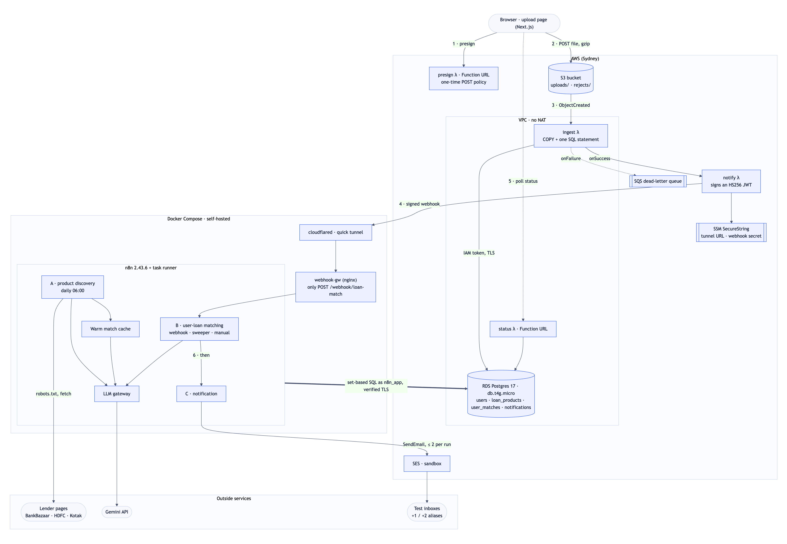

# Loan Eligibility Engine

Upload a CSV of customers and the system works out which personal loans each of them is likely
eligible for, using the criteria lenders publish on their own websites, then emails the people
who have a match.

The AWS side takes care of ingestion. The browser uploads the file straight to S3 with a
presigned POST, and a Lambda loads it into RDS Postgres. Everything after that runs in a
self-hosted n8n:

- Workflow **A** crawls lender pages every day.
- Workflow **B** matches each new batch of users against the products.
- Workflow **C** sends the emails.

For the 10,000-row sample and 24 products, the 2,40,000 possible (user, product) checks come
down to a single question for the LLM. That question is answered right after the daily crawl, so
an upload makes no LLM calls at all. Matches agree with a brute-force check of every pair at 1k,
10k and 100k users.

> **Demo video (5–10 min):** _link to be added_
<!-- Paste the link here, e.g. [Watch the demo](https://...) -->

| Brief ([docs/ASSIGNMENT.md](docs/ASSIGNMENT.md)) | Where it lives |
|---|---|
| Scalable, event-driven CSV ingestion into RDS | presigned S3 POST → S3 event → ingest Lambda ([§1](#1-architecture), [§4](#4-ingestion)) |
| n8n in Docker; workflows A, B and C | [docker-compose.yml](docker-compose.yml), [n8n/workflows/](n8n/workflows/), described in [§3](#3-workflow-design) |
| Optimisation treasure hunt | [§2](#2-the-optimisation-treasure-hunt), with the measurements in [docs/EXPERIMENTS.md](docs/EXPERIMENTS.md) |
| Emails through the SES node, only to test aliases | Workflow C, capped at 2 per run, never to a CSV address |
| Minimal upload UI | [ui/](ui/), a static Next.js page that follows each batch to the end |
| `serverless.yml`, setup, credentials | [infra/serverless.yml](infra/serverless.yml), [§5](#5-setup-and-deployment) |

## 1. Architecture



What happens to one upload:

1. The page asks the **presign** Lambda for a one-time S3 POST policy. The policy fixes the key,
   the content type and a 50 MB limit, and it expires in 5 minutes. The browser gzips the CSV and
   posts it straight to S3, so the file never goes through API Gateway (10 MB limit) or a Lambda
   payload (6 MB).
2. The S3 event invokes **ingest** inside the VPC. It streams the object into a Postgres `COPY`,
   and one SQL statement then validates, de-duplicates and upserts every row in a single
   transaction.
3. A Lambda Destination passes ingest's result to **notify**, or to an SQS dead-letter queue if
   ingest failed. Notify signs a JWT and posts it through a Cloudflare tunnel to an nginx gateway
   that forwards a single path, `POST /webhook/loan-match`, to n8n.
4. **Workflow B** checks the token, replies 202, matches the batch with two SQL statements and
   calls **Workflow C**. C records every notification and sends up to two emails through SES.
5. The page polls the **status** Lambda. One query returns the batch's timeline, the counts for
   each stage and the funnel shown on the page.

A few choices worth explaining:

- **IAM database auth for the Lambdas inside the VPC.** There is no NAT gateway, so these
  Lambdas can't reach SSM or Secrets Manager. An RDS IAM token is a SigV4 signature computed
  offline, so no password is stored anywhere. n8n connects as a separate role, `n8n_app`, which
  has no DELETE rights.
- **Lambda Destinations rather than an S3 "done" marker.** The Lambda service delivers them
  even from a VPC without NAT, they hand the row counts to notify, and failures end up in the
  DLQ.
- **Faster cold starts on the page's path.** presign and status sign requests with about 150
  lines of standard-library SigV4, pinned to botocore's output by tests, instead of importing
  boto3. That saves 120–250 ms per cold start.
- **The webhook is the only thing exposed.** It is an HS256 JWT checked by the n8n Webhook node,
  so the secret stays in an encrypted credential. A quick tunnel pointed straight at n8n would
  have published the editor, so the gateway forwards only that one path and the editor listens
  on localhost.
- **Settings live in an `app_config` table, not `$env`.** This keeps n8n's
  `N8N_BLOCK_ENV_ACCESS_IN_NODE=true` default in place.
- **A sweeper on Workflow B** matches any batch whose webhook was lost, within 10 minutes.

The AWS account is limited to ap-southeast-2 (Sydney) by its sign-up type, while n8n runs on a
laptop in Bengaluru. So the workflows are written to need few database round trips: B makes 2
per batch, C makes 1 and the warm step 1. Before this they made 8 in total. The region is set in
one place, `AWS_REGION` ([DECISIONS AD27](docs/DECISIONS.md)).

## 2. The optimisation treasure hunt

### The cost of the naive approach

Each user $u$ has facts $x_u$ = (income, credit score, age, employment). Each of the $M$ active
products $p$ has

- hard rules $H_p$: stated thresholds, plus conditional rules the crawler could compile, such as
  "salaried applicants need ₹30,000";
- fuzzy criteria $F_p$ that need judgement, such as "employees of private limited companies".
  For each one, the extraction records which facts it depends on, $D_f$.

Asking an LLM about every pair costs

$$C_0 = N \cdot M \quad\text{calls,}$$

which is 2,40,000 calls for this sample. At the free tier's 10 requests a minute that is about 17
days for a single upload, and it grows linearly with users.

### The pipeline

**S2: hard filter.** One set-based SQL join inside Postgres keeps only the pairs that pass the
stated rules:

$$Q = \{(u,p) : x_u \in H_p\}$$

A missing (NULL) threshold never filters anyone out, so recall comes first. Because this runs in
the database, n8n never holds users × products. At 100k users that would mean moving 15 MB of
users in and 2.4M items out.

**Pending questions.** Only pairs whose product has a fuzzy criterion need judgement:

$$R = \{(u,p,f) : (u,p) \in Q,\ f \in F_p\}$$

**S3: cohorts.** A fuzzy criterion only sees the facts it depends on, so each question maps to a
cohort:

$$c(u,p,f) = \big(\kappa(f),\ \beta_p(x_u|_{D_f})\big)$$

Here $\kappa(f)$ hashes the criterion's wording and dependencies, so products that use the same
wording share verdicts. $\beta_p$ bands each numeric fact against the product's own thresholds:
with *threshold banding* a number becomes just "inside the product's range", while employment
stays exact. The number of cohorts therefore depends only on the products:

$$|C| \le \sum_{f} \prod_{d \in D_f} B_d,\qquad B_{\text{employment}} \le 3,\ B_{\text{numeric}} = 1$$

$N$ does not appear in the bound. As users arrive, the observed cohorts fill it like a coupon
collector, $E[\text{distinct after } n] = \sum_c \big(1-(1-\pi_c)^n\big)$, which levels off. On the
synthetic stress-test products it is 19 cohorts at 1k, 10k and 100k users alike.

**S4: cache.** Each verdict is stored once per $(\kappa, \text{band})$ in `llm_decisions` and
reused from then on.

**S5: batched calls, two judges.** Each request carries up to $K = 25$ cohorts. A second judge
compiles each criterion once into clauses over the exact facts. For a criterion with cohort
verdict $c$ and rule verdict $r$, the final verdict is

$$
v = \begin{cases}
c & r = \varnothing \ \text{or}\ r = c \\
\text{ineligible} & c = \text{uncertain},\ r = \text{ineligible} \quad\text{(veto)} \\
\text{uncertain} & \text{otherwise}
\end{cases}
$$

So the rule can veto an uncertain verdict but can never vouch for one, and any disagreement
keeps the pair as "may qualify". The calls a batch needs are

$$\text{calls} = \left\lceil \frac{U}{K} \right\rceil + \left\lceil \frac{V}{25} \right\rceil$$

where $U$ is the number of uncached cohorts and $V$ the number of criteria without a compiled
rule.

**Warming.** `cohort_space()` lists every cohort the active products could produce, from the
products alone. Workflow A ends by judging those through the warm sub-workflow, so by the time a
batch arrives $U = V = 0$ and it makes **0 calls**. B keeps its own LLM branch for anything the
warm step missed.

### The numbers

The sample file against the current catalogue, as the upload page reports them:

| Stage | What is left | Count |
|---|---|---|
| S0 naive | (user, product) pairs | 2,40,000 |
| S2 hard filter | pairs passing the stated rules | 61,937 |
| pending | pairs with a fuzzy criterion | 1,840 |
| S3 cohorts | distinct (criterion, band) | 1 |
| S5 LLM calls | at upload time / once per product change | **0** / 2 |

To pick the LLM stage, I scored 14 strategies against a per-pair oracle: one question per call,
with the exact facts, on 109 pairs. A false drop hides a product the customer might qualify for,
so zero false drops was the first requirement. These are the strategies that matter:

| Strategy | Calls (10k users) | False drops | Rejections caught |
|---|---|---|---|
| per pair (the oracle) | 50,489 | 0 | 14 / 14 |
| rules only, no LLM | 0 | 0 | 0 / 14 |
| threshold cohorts | 1 | 0 | 6 / 14 |
| **threshold cohorts + rule veto (chosen)** | **2** | **0** | **10 / 14** |
| coarse cohorts, 25 per call | 2 | 11 | 9 / 14 |
| one call per user | ≈ 10,000 | 6 | 13 / 14 |

Packing finer bands into one request led the model to draw lines between adjacent bands, which
dropped pairs it shouldn't have. Threshold cohorts only ask questions that can be answered for a
whole range. On a held-out sample, the oracle confirmed every one of the 40 pairs the chosen
strategy dropped, and the strategy caught an estimated 92% of what per-pair judging rejects.

It scales flat. These runs used `make bench` on synthetic products with 15 fuzzy criteria, since
the real pages yield only one:

| Users | Naive calls | After S2 | Pending | Cohorts | Calls cold | Calls warmed | Recall |
|---|---|---|---|---|---|---|---|
| 1,000 | 25,000 | 11,601 | 5,064 | 19 | 2 | 0 | 1.000 |
| 10,000 | 2,50,000 | 1,15,896 | 50,489 | 19 | 2 | 0 | 1.000 |
| 1,00,000 | 25,00,000 | 11,56,519 | 5,03,545 | 19 | 2 | 0 | 1.000 |

Once the LLM was off the critical path, writing the matches became the cost. Four changes fixed
that:

- **Statement-level reference checks** instead of row-level foreign keys: 51 s became 12 s at
  100k users.
- **Plain INSERTs for new users**, so only returning users go through an upsert.
- **A BRIN index on batch.**
- **One row per user** (`user_matches`) instead of one per pair, with `matches` kept as a view.
  The write fell from 1.16 to 0.37 s at 10k users and from 25.5 to 8.3 s at 100k, with 6–8× less
  WAL.

Through n8n a 10k batch is matched about 1 s after the webhook. On the deployed stack, from India
to Sydney, a 10k upload takes about 13 s from drop to done.

These trade-offs were accepted on purpose:

- A cohort verdict applies to everyone in that cohort.
- Cached verdicts last until a criterion's wording changes.
- Roughly 8% of what a per-pair LLM would reject goes out as "may qualify" instead.

Recall against the stated rules is never traded. All 14 strategies, the method and the
trade-offs are in [docs/EXPERIMENTS.md](docs/EXPERIMENTS.md).

I also considered and dropped these alternatives:

- **Embeddings.** The facts are structured numbers, so there is nothing semantic to retrieve.
- **A classifier trained on LLM labels.** It would only approximate rules that can be written
  down exactly.
- **Matching in a Code-node loop.** It is exact, but its working set grows with N × M, while
  the SQL keeps the data in the database.

## 3. Workflow design

The workflows are built from templates in [n8n/src/](n8n/src/). Their SQL lives in [sql/](sql/)
and their Code-node JavaScript in [n8n/code/](n8n/code/), both injected at build time, so the
same code runs in n8n, the tests and the bench. Every canvas has sticky notes. A few rules apply
throughout:

- A SQL node does a whole step in one round trip.
- No node ever holds users or pairs, only cohorts, LLM requests or emails.
- Every workflow is safe to re-run.

**A · Loan product discovery** runs daily at 06:00 and loops over the sources:

1. Read robots.txt and check each URL against it.
2. Fetch the pages with an honest User-Agent.
3. Clean them into text that keeps table rows as `cell | cell`. BankBazaar's 711 KB of HTML
   becomes 50 KB.
4. Hash the text with SHA-256. **If nothing changed, skip the LLM.**
5. Otherwise extract through the LLM gateway, validate in code, upsert with a criteria-history
   diff, and close the crawl run.

After the loop it retires products not seen for 7 days, writes a summary and calls the warm
step. Every Code node has an error output, so a failing source closes its own run as `error`
and the loop moves on.

How the crawl works:

- **Sources.** BankBazaar (an aggregator with rate and eligibility tables for 20+ lenders),
  HDFC Bank and Kotak, with Hero FinCorp as a backup. I picked pages whose criteria are in the
  server-rendered HTML. Eight other sites were rejected for bot walls, moved pages or
  JavaScript-only data ([DECISIONS](docs/DECISIONS.md#crawl-sources)).
- **Extraction.** The LLM reports what the page says, with a confidence per field, and sorts
  leftover criteria into `compilable`, `fuzzy` or `unknown_field`. Code then decides what
  actually filters: it converts annual income to monthly, uses the most permissive income tier,
  reads stated score minimums, and keeps low-confidence fields out of the filter.
- **Product identity.** Products are keyed by lender and normalised name, so a reworded
  extraction updates a product instead of duplicating it.
- **Fixtures.** `CRAWL_MODE=fixtures` (the default) serves saved copies of the real pages
  through the same HTTP nodes, so tests and demos don't depend on live sites. `live` crawls
  the real pages.

**B · User-loan matching** has three triggers that share one path: the signed webhook, a
sweeper every 10 minutes and a manual run.

1. Read token claims. Only the verified claims are trusted, never the request body.
2. Loop over the batches.
3. **Claim batch.** One statement claims the batch idempotently, reads the config and returns
   only the uncached cohorts.
4. If any are uncached: build cohort requests → judge them through the gateway → store the
   verdicts.
5. **Write matches.** One statement inserts every pair once, with its final status and the
   metrics for each stage.
6. Call C.

A failure marks the batch failed with its reason, and the page shows that reason.

**C · User notification**:

1. **Plan notifications.** One statement refuses to do anything unless the email settings are
   safe. It then records a notification row for every user with new offers: the first
   `EMAIL_CAP` get a test alias as recipient and everyone else is marked `suppressed`. It never
   selects `users.email`.
2. Render the emails, HTML and text, escaped.
3. Check the recipients: each must be an alias, used once, and from the configured sender.
4. Send through the AWS SES node one at a time, recording each result and pausing to stay under
   the SES rate.

A rerun sends nothing.

**LLM gateway** is a sub-workflow and the only place that calls a model.

- It returns the same shape for every request.
- It checks the daily budget before each call.
- It sends requests in parallel, paced under the RPM limit.
- It retries 429 and 5xx responses with backoff and logs every attempt.

**Warm match cache** is one query plus the same nodes B uses to judge cohorts.

## 4. Ingestion

| Concern | Handling |
|---|---|
| Large files | The file goes straight to S3, gzipped. Ingest streams it into `COPY` at about 50k rows/s, so 100k rows take about 2 s |
| Validation | One SQL statement with ordered `CASE` checks, so a value is only cast once it's known to be castable. Checks: UUID id, name, email shape, income > 0, score 300–900, employment category, age 18–100 |
| Messy CSVs | Columns matched by name in any order; extra columns ignored; BOM and CRLF accepted; values trimmed |
| Bad rows | Each is skipped with a reason in `rejects/<batch>.csv` (line, reason, raw values). For a repeated `user_id` the last row wins |
| Unreadable files | Missing columns, a corrupt gzip, NUL bytes or a field over 128 KB: the whole file is refused with a reason, which the page shows |
| Duplicate S3 events | Idempotent on (bucket, key, etag) |
| Failures | Database logins are hedged and never cancelled (a fresh container's RDS IAM check can take seconds), and a 5-minute schedule keeps ingest and status logged in. Then come Lambda's async retries, then the DLQ. The sweeper catches a lost webhook ([AD41](docs/DECISIONS.md)) |

The rejection reasons are checked against an independent Python validator: on a 100k file with
2,036 injected faults, each reason's count matches the number of faults of that kind.

## 5. Setup and deployment

You need Docker, [uv](https://docs.astral.sh/uv/), Node 24 and make. For AWS you also need the
AWS CLI and a free Serverless Framework v4 login. The file avoids v4-only syntax, so
[osls](https://github.com/oss-serverless/osls) can deploy it too.

### Run locally

```bash
make setup         # Python env from uv.lock
make env           # .env from .env.example, with every local secret generated
                   # then set GEMINI_API_KEY in .env (free key from aistudio.google.com)
make bootstrap     # containers, migrations, app_config, credentials, workflows, publish (re-runnable)
make crawl         # Workflow A once, then the warm step
make ui-install && make ui      # upload page on http://localhost:8090
```

n8n is at http://localhost:5678. Create the owner account on your first visit; the workflows and
credentials are already imported and published.

### n8n credentials

`make bootstrap` builds these four from `.env` and imports them under fixed IDs, so the
workflows find them without any edits. n8n encrypts them on import, and none are in git.

| Credential | Type | Holds | Used by |
|---|---|---|---|
| App DB (n8n_app) | Postgres | Local: host `app-db`, db `loans`, user `n8n_app`, `N8N_APP_DB_PASSWORD`. RDS: `RDS_HOST`, `RDS_N8N_APP_PASSWORD`, SSL `require` | every SQL node |
| AWS SES (send-only IAM user) | AWS | `AWS_REGION`, `SES_AWS_ACCESS_KEY_ID`, `SES_AWS_SECRET_ACCESS_KEY` | C's SES node |
| Webhook JWT (HS256) | JWT Auth | passphrase `WEBHOOK_HMAC_SECRET`, algorithm HS256 | B's webhook |
| Gemini API key | Header Auth | `x-goog-api-key: GEMINI_API_KEY` | LLM gateway |

To create them by hand instead, go to **Credentials → New** in n8n and enter the same values.
For RDS, leave "Ignore SSL issues" off: compose mounts the RDS CA bundle and sets
`NODE_EXTRA_CA_CERTS`, so the certificate is verified. Bootstrap refuses to import an AWS key
that also appears in `~/.aws/credentials`, which keeps admin keys out of n8n.
`make use-rds` and `make use-local` switch the database credential and `app_config` between RDS
and the local database.

### SES

Verify the sender and both aliases as identities in SES (ap-southeast-2), for example
`you@gmail.com`, `you+1@gmail.com` and `you+2@gmail.com`. The SES sandbox only delivers to
verified addresses. Then create an IAM user for n8n with only this policy and put its keys in
`SES_AWS_*`:

```json
{
  "Version": "2012-10-17",
  "Statement": [{
    "Effect": "Allow",
    "Action": ["ses:SendEmail", "ses:SendRawEmail"],
    "Resource": [
      "arn:aws:ses:ap-southeast-2:<account-id>:identity/you@gmail.com",
      "arn:aws:ses:ap-southeast-2:<account-id>:identity/you+1@gmail.com",
      "arn:aws:ses:ap-southeast-2:<account-id>:identity/you+2@gmail.com"
    ]
  }]
}
```

Set `SES_SENDER`, `EMAIL_ALIASES` and `EMAIL_CAP=2` in `.env`. Set `EMAIL_MODE=test_aliases`
to send, or `suppressed` (the default) to record and preview without sending. Gmail may file
these emails as spam, because gmail.com's DMARC policy is `p=none`.

### Deploy to AWS

```bash
echo "MY_IP_CIDR=$(curl -s https://checkip.amazonaws.com)/32" >> .env   # the only IP RDS accepts besides the Lambdas
make tunnel          # Cloudflare quick tunnel to webhook-gw
make aws-params      # SSM: RDS master password, webhook secret, tunnel URL
make deploy          # VPC, bucket, 4 Lambdas, DLQ, RDS (about 12 min)
make migrate-rds && make catalog-to-rds && make rds-ca
make use-rds         # point n8n at RDS
UI_TARGET=aws make ui
```

`make deploy` ends by logging the Lambdas in to RDS (`make warm`), so the first upload is fast.
`make aws-upload` sends `data/warmup.csv` through the whole AWS path, timed, without sending
any email. After the laptop sleeps or the network changes, the tunnel needs restarting:
`make tunnel && make tunnel-ssm`. Stop RDS
between sessions with `make rds-stop`. `make destroy` removes everything.

### Seeing every branch of every workflow

Each workflow is built to skip work it has already done. A second run of A finds the pages
unchanged and skips the LLM. B's manual run stops at "Nothing waiting" when no batch is waiting.
C finds the batch already notified. `make demo-reset` undoes exactly those skips, and it never
deletes users, products, matches or notifications:

```bash
make demo-reset                              # A re-extracts hdfc-bank; the warm cache is cleared
make demo-reset ARGS="--cold-batch 1000"     # a waiting batch with nothing cached, for B's "Run manually"
make demo-reset ARGS="--target rds"          # the same against RDS
```

## 6. Testing and repository

`make check` runs ruff, mypy `--strict`, **185 Python tests** and **73 JavaScript tests**, and
fails if the generated workflows or the data profile are out of date. The Python tests run
against throwaway databases and cover:

- ingest, checked against an independent validator;
- every Lambda handler, under moto;
- SigV4 output equal to botocore's;
- the matching and notification SQL, run as `n8n_app`;
- workflow shape rules;
- the cost guards on `serverless.yml`.

`make match-e2e` compares n8n's matches with brute force and reports recall and precision of
1.0000. The [docs/TESTING.md](docs/TESTING.md) guide lists manual checks with their expected
output.

```
infra/serverless.yml   AWS stack          services/   the four Lambdas + shared code
docker-compose.yml     n8n stack          sql/        migrations and workflow SQL
n8n/src, n8n/code      workflow sources   ui/         upload page
n8n/workflows          importable JSON    bench/      optimisation bench and results
```

For more depth, [docs/DECISIONS.md](docs/DECISIONS.md) explains every design decision and its
measurement, and [docs/EXPERIMENTS.md](docs/EXPERIMENTS.md) holds the treasure-hunt data.

**Cost and limits.** Running this costs about $0. The only billed item is RDS's public IPv4
address (about $0.005 an hour) while RDS runs. Gemini stays on its free tier: an unchanged crawl
costs nothing, and so does an upload.

What I would do next:

- Run n8n in the same region as RDS, behind a named tunnel or a private link.
- Add the prompt version to the cache key, so that a model upgrade re-judges each cohort once.
- Spot-check a few users per cohort during the crawl.
